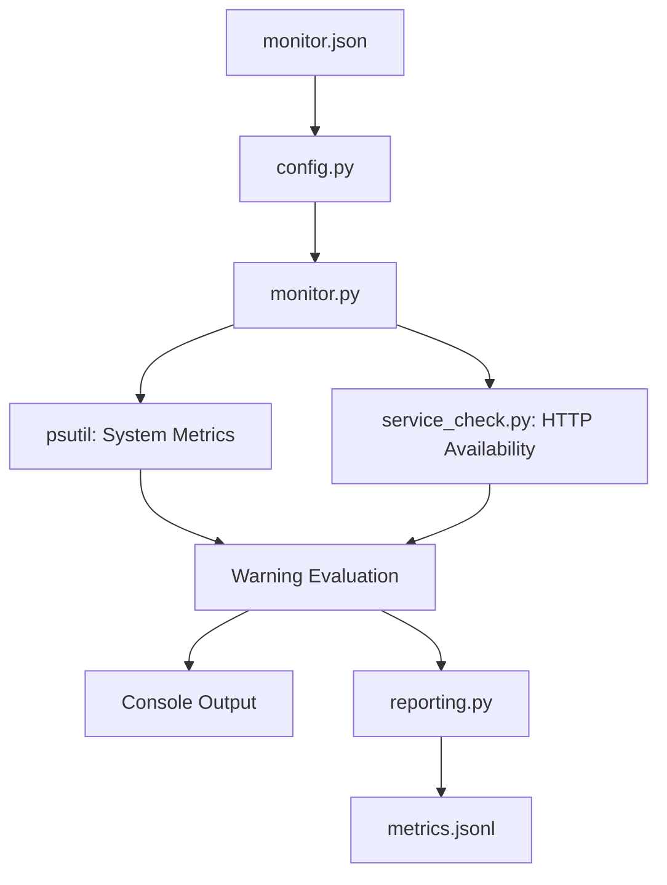

# Infrastructure Health Monitor — Architecture

## System Overview

The Infrastructure Health Monitor is a locally executed Python application designed to collect system metrics, evaluate monitoring rules, check HTTP service availability, and save structured monitoring records.

The application uses a modular architecture to separate configuration, data collection, warning evaluation, and reporting.

## Architecture Diagram

## Component Responsibilities

| Component | Responsibility |

|---|---|

| monitor.py | Coordinates application execution |

| config.py | Loads and validates configuration |

| alert_rules.py | Evaluates sustained resource utilization |

| service_check.py | Checks HTTP endpoint availability |

| reporting.py | Writes timestamped JSONL reports |

| monitor.json | Stores monitoring settings |

| psutil | Provides system resource measurements |

## Execution Workflow

1. Load the configuration file.

2. Validate configuration settings.

3. Collect three system resource samples.

4. Check the configured HTTP endpoint.

5. Evaluate warning conditions.

6. Display monitoring results.

7. Append a timestamped monitoring record.

8. Return an application exit code.

## Reliability Design

The application distinguishes between monitored infrastructure problems and application execution failures.

- Exit code 0 indicates successful monitoring and reporting.

- Exit code 1 indicates report-writing failure.

- Exit code 2 indicates configuration loading or validation failure.

## Security Boundaries

The default HTTP test endpoint is localhost.

The application does not require elevated privileges for its current monitoring functionality.

Local monitoring records are excluded from the Git repository.

## Deployment Scope

The current implementation is a local, single-execution monitoring tool.

It is not a distributed monitoring platform, background service, or centralized monitoring system.
